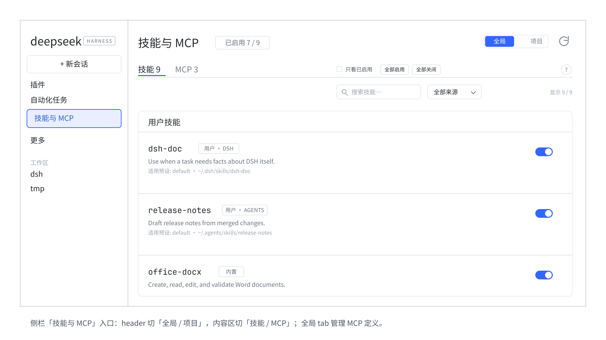
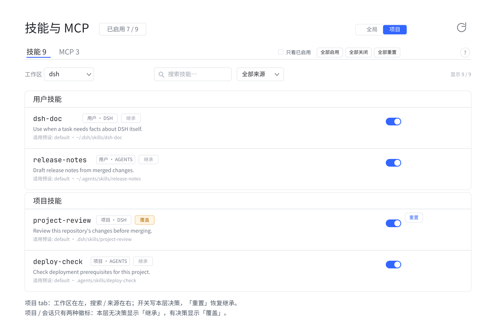
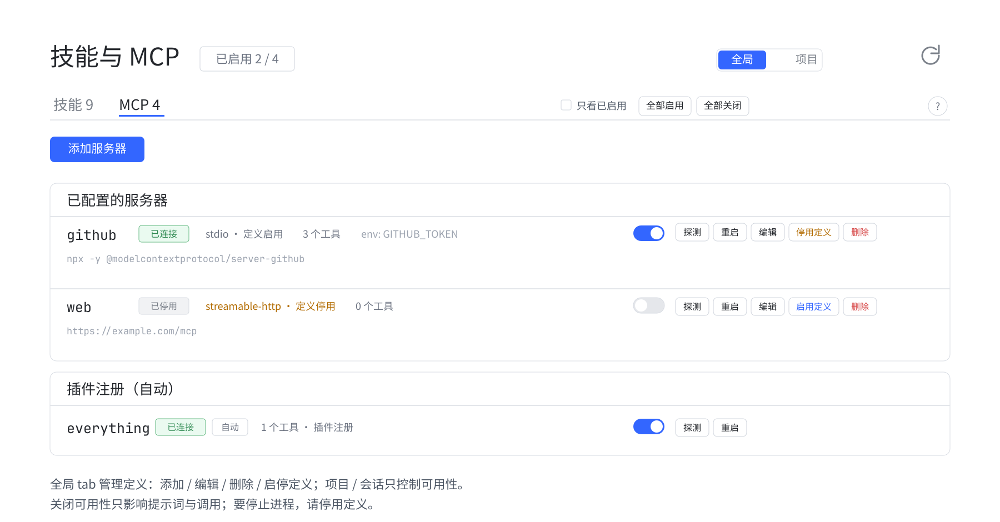
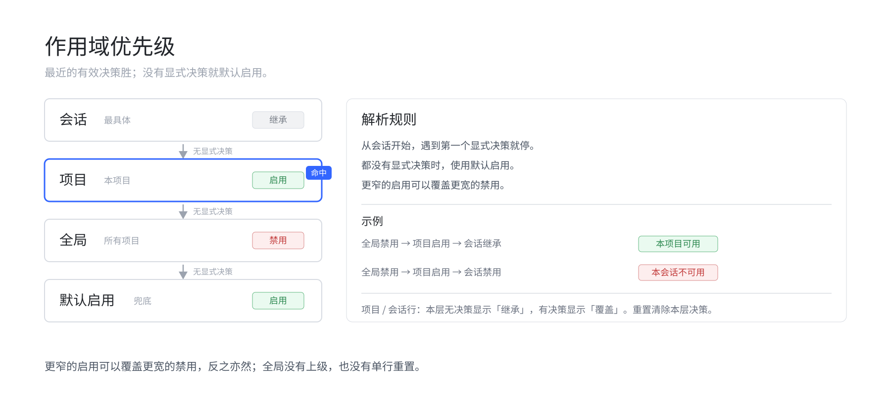

# Skills & MCP

[中文](README.md)

A DeepSeek Harness Web plugin: browse the skills that actually take effect, enable or disable skills and MCP servers per global, project, and session scope, and manage MCP definitions, status, and tools from one panel.

No runtime dependencies; no imports from DSH internals.

## Features

### Two surfaces

| Surface | What it does |
|---|---|
| Sidebar “Skills & MCP” | The only configuration surface: the header switches `Global / Project`, the content switches `Skills / MCP`; a project scope picks a workspace; the Global tab owns MCP definitions |
| Conversation View tab | The same type tabs / search / source filter / “only enabled” as the main page; no repeated “Session” marker; refresh kept in the header (spins until the reload finishes); session overrides |

The images below are diagrams; labels are in Chinese.

<a href="docs/images/entry.png"></a>

Sidebar page structure:

- The header holds only the title, the `Global | Project` scope switch, and refresh; **no workspace control**. Clicking refresh spins the icon until the reload finishes.
- Content tabs are `Skills | MCP`; MCP is never pushed below a long skill list.
- On the project Skills tab, the workspace selector shares a row with search (workspace left, search/source right); the MCP tab keeps a separate workspace row; global/session show no workspace.
- The Skills tab supports name/description search and source filtering; sources are split into User DSH (`~/.dsh/skills`), User AGENTS (`~/.agents/skills` / `$DSH_AGENTS_HOME/skills`), Project DSH (`.dsh/skills`), Project AGENTS (`.agents/skills`), Built-in, Plugin, Custom, and Other.
- Both the Skills and MCP tabs support “only enabled”, aligned to the right of the toolbar.
- Each Skills/MCP tab bar has a `?` at the right: clicking it shows the current scope explanation (no permanently visible long notice); the same row also has “only enabled” and the bulk bar: global offers only “Enable all / Disable all”, while project/session also have “Reset all”. The bulk action applies to the rows currently shown in that tab and refreshes afterwards; project/session Reset all clears the local decision and returns to inheritance.
- The project Skills tab’s workspace selector shares a row with search; the MCP tab’s workspace row only keeps the selector; the project MCP note is merged into the MCP tab’s `?`, so there is no second question mark.
- MCP add/edit/remove and definition toggles live in the Global tab; the Project tab only controls availability.

The Conversation View reuses the same page: no repeated “Session” marker (it is already the session entry), refresh kept in the header (spins until the reload finishes); `Skills | MCP` type tabs; skills search/source filtering and “only enabled” on both tabs (right-aligned); grouping by source/definition; no workspace selector and no definition add/edit.

### Skills

- The catalog comes from the DSH skill registry, unioned across **presets**: each preset's own `skill-filesystem` discovery contributes, so built-in and plugin skills are included.
- Only the final effective definition is shown; same-name shadowed files and malformed files on disk are not listed.
- Skills are never copied, moved, or modified. Disabling registers a same-name runtime stub in the agent's layer, so the model catalog, the `skill` tool, and the `/` menu hide it together.
- The definition (SKILL.md) stays on disk. This plugin does not create, edit, or delete skill files.

<a href="docs/images/skills.png"></a>

### MCP

- **Definition axis**: the mcp-manager entry's `enabled`. Turning it off unmounts the instance and stops the process; no scope can override it.
- **Availability axis**: this plugin's global / workspace / session decisions, enabled by default; a narrower enable overrides a wider disable.
- When availability is off, the server's `mcp__<server>__*` tool schemas disappear from the agent view and calls are denied; its instructions are shadowed by a same-name empty section; resource calls are denied by `tools/pre-execute`.
- **Definition management**: name, stdio/streamable-http, command, arguments, cwd, URL, headers, environment, timeouts, definition enable. Writes use Settings' persistence and revision checks.
- **Form + JSON**: adding a server offers both a form and a JSON object input (name, transport, command/args or url/headers, env/headers key-value objects). JSON is add-only; editing stays on the form so masked values are preserved.
- **No value leaks**: existing env/header values are returned as masked keys only; leave a value blank to keep it, type to replace it, remove the key to delete it. `GET /api/skills-mcp` never contains env/header values.
- Statuses: `connected / connecting / reconnecting / waiting-credentials / failed / disabled / missing / removed / closed`; probe and restart are available.
- Plugin-registered servers (`configured:false`) appear under “Auto”; their definition is read-only while availability remains controllable.

<a href="docs/images/mcp.png"></a>

### Scope precedence

The nearest explicit decision wins; no explicit decision means enabled:

```
session → workspace → global → default enabled
```

- Global disabled → project enabled: available only inside that project (the global decision is overridden).
- Global disabled → project enabled → session disabled: unavailable in that session (the project decision is overridden).
- Project/session rows have only two decision states: no local decision shows “Inherited”; a local decision shows “Overridden”. Global has no parent and shows no such badge.
- An overridden project/session row has a “Reset” button next to its switch: click it to clear the local decision and inherit again; the button hides once the row is inherited. Global has no single-row reset.
- The switch writes an explicit decision for the current scope; project/session can use “Reset” to return to inheritance, while global only has the switch.

<a href="docs/images/scope.png"></a>

### Token cost

| State | The server's tools | Instructions | Resource calls | Shared resource tools + name list | Process |
|---|---|---|---|---|---|
| Definition disabled | none | none | none | kept only while another MCP server exists | stopped |
| Availability off (definition still on) | hidden from the agent view | shadowed by an empty section | denied | **kept** (three shared tools + one name line) | still running |

- The shared resource tools and the name line are a fixed small cost shared by every MCP server. For a total zero, disable the definition; the tradeoff is that no project or session can re-enable it.
- Content already in conversation history is not removed by disabling.

## Install

Add the link dependency and bundle to the Web profile:

```jsonc
{
  "dependencies": {
    "@local/dsh-skills-mcp": "link:/workspace/dsh/skills-mcp"
  },
  "dsh": {
    "profile": {
      "bundles": [
        // ...
        "@local/dsh-skills-mcp"
      ]
    }
  }
}
```

```sh
cd /data/dsh/profiles/web
pnpm install
```

Then enable `@local/dsh-skills-mcp` in the plugin manager (or disable and enable it once) and refresh the page.

The row is inserted by `cordis.patch.yml`:

```yaml
- insert:
    - id: skills-mcp
      name: '@local/dsh-skills-mcp'
```

### Optional configuration

| Field | Default | Meaning |
|---|---|---|
| `path` | `$DSH_HOME/storages/skills-mcp.json` | Decision store path |
| `mcpNamespace` | `mcp-manager` | mcp-manager's Settings namespace; auto-detected by schema when absent |

## Data

Decisions live in `$DSH_HOME/storages/skills-mcp.json` (0600, atomic write):

```json
{
  "version": 1,
  "skills": {
    "global": { "decisions": { "dsh-doc": { "state": "disabled", "meta": { "description": "..." } } } },
    "workspaces": { "<workspaceId>": { "decisions": {} } },
    "sessions": { "<sessionId>": { "decisions": {} } }
  },
  "mcp": {
    "global": { "decisions": { "github": { "state": "disabled" } } },
    "workspaces": { "<workspaceId>": { "decisions": {} } },
    "sessions": { "<sessionId>": { "decisions": {} } }
  }
}
```

MCP definitions stay in the profile's Cordis configuration (persisted by Settings/config-editor); this plugin only reads, validates, and writes them.

## HTTP API

Route: `/api/skills-mcp` (authenticated by the DSH connection; same-origin Web clients only).

- `GET ?op=overview`
- `GET ?op=skills&scope=global|workspace|session[&workspaceId=...][&sessionId=...]`
- `GET ?op=mcp&scope=...`
- `GET ?op=mcpStatus`
- `POST`: `setSkillDecision`, `setMcpDecision`, `addMcp`, `updateMcp`, `removeMcp`, `resetMcp`, `setMcpEnabled`, `probeMcp`, `restartMcp`

Responses are `{ ok: true, data }` or `{ ok: false, error, message }`.

## Known limitations

- Skills show only the effective definition; shadowed or malformed files on disk are not scanned.
- MCP definitions are global: projects and sessions control availability only, not project-specific servers. Static mcp-client rows in `cordis.yml` or a preset are not managed by mcp-manager, so this plugin neither lists nor gates them.
- A soft-disabled server still keeps the shared MCP resource tools and one server-name line (a fixed small cost).
- A cold session (no live agent) uses the preset scope for its `/` menu; a disabled skill may briefly appear until the agent exists.
- Content already in history is not removed.
- Subagents inherit the root session's decisions; if the root cannot be resolved, the child falls back to itself.
- Server instructions are shadowed through the current `mcp:<server>` section-name contract.
- No OAuth / needs-auth flow.

## Development

```sh
npm install   # test dependencies only (React / happy-dom)
npm test      # host unit tests + client contract + UI smoke tests
npm run test:host
```

- Host: `index.js` + `src/*.js` (plain ESM, zero runtime dependencies).
- Client: `client.js`, loaded by the DSH Web module loader.
- Host changes need a plugin-manager disable→enable; `client.js` changes need a page refresh.

Current suite: **91 tests** (74 host + 7 client contract + 10 UI smoke).

## Layout

```
index.js              plugin entry (lifecycle, route, agent gating)
src/core.js           decision model (pure)
src/store.js          atomic JSON store
src/catalog.js        preset/workspace/session skill catalog
src/mcp.js            mcp-manager + Settings adapter
src/gate.js           skill stubs / MCP restriction / section / guard
src/service.js        HTTP views and decision writes
src/http.js           route
client.js             the sidebar page, conversation view, and MCP form
```

## License

MIT
