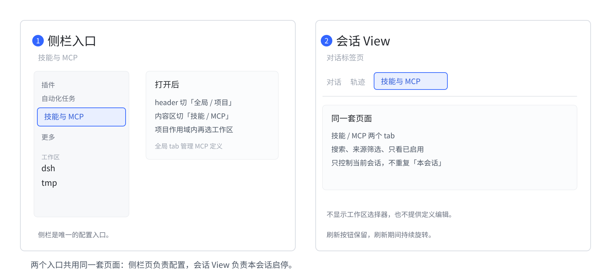
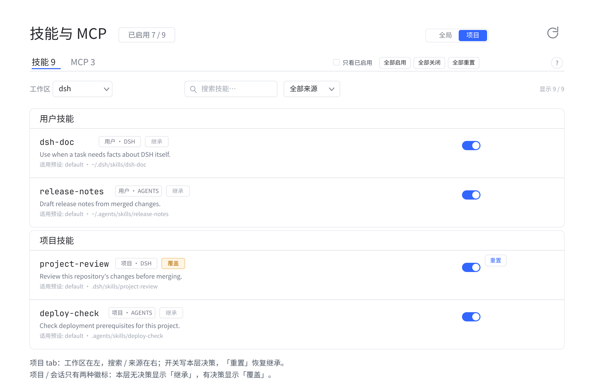
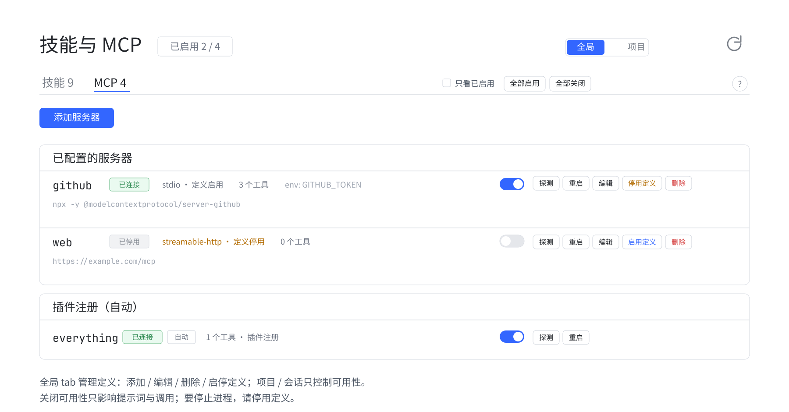
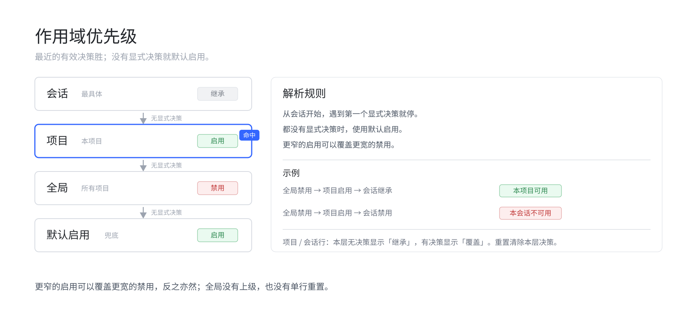

# Skills & MCP · 技能与 MCP

[English](README.en.md)

DeepSeek Harness 的 Web 插件：在一个面板里查看**实际生效**的技能，按全局、项目、会话启停技能与 MCP 服务器，并管理 MCP 服务器的定义、状态与工具。

运行时零依赖，不导入任何 DSH 内部包。

## 功能

### 两个入口

| 入口 | 作用 |
|---|---|
| 侧栏「技能与 MCP」 | 唯一的配置入口：header 切 `全局 / 项目`，内容区切 `技能 / MCP`；项目作用域内选择工作区；全局 tab 管理 MCP 定义 |
| 会话 View 标签 | 与主页面同一套类型 tab / 搜索 / 来源筛选 / 只看已启用；不重复「本会话」标记；header 保留刷新（刷新期间持续旋转，完成后停止）；会话级启停 |

以下配图都是示意图。

<a href="docs/images/entry.png"></a>

侧栏页面结构：

- header 只有标题、已启用计数、`全局 | 项目` 作用域切换和刷新，**没有工作区控件**；点击刷新后图标持续旋转，数据返回后停止。
- 内容区一级 tab 是 `技能 | MCP`；MCP 不会被技能列表挤到下面。
- 项目技能 tab：工作区选择器与搜索在同一行，工作区在左、搜索/来源在右；MCP tab 保留单独的工作区行；全局/会话不显示工作区。
- 技能 tab 支持按名称/描述搜索和按来源筛选；来源细分为用户 DSH（`~/.dsh/skills`）、用户 AGENTS（`~/.agents/skills` / `$DSH_AGENTS_HOME/skills`）、项目 DSH（`.dsh/skills`）、项目 AGENTS（`.agents/skills`）、内置、插件、自定义和其他。
- 技能和 MCP 两个 tab 都支持「只看已启用」，统一放在 tab 栏右侧。
- 技能/MCP 的 tab 栏右上角有一个 `?`：点击显示当前作用域说明（不再常驻长提示）；同一行右侧还有「只看已启用」和批量栏：全局只有「全部启用 / 全部关闭」，项目/会话另有「全部重置」。批量操作作用于当前 tab 当前显示的条目，完成后自动刷新；项目/会话的全部重置清除本层决策并回到继承。
- 项目技能 tab 的工作区选择器与搜索合并成一行；MCP tab 的工作区行只保留选择器；项目 MCP 的说明合并到 MCP tab 的 `?` 里，不再出现第二个问号。
- MCP 的添加/编辑/删除/定义启停在全局 tab；项目 tab 只控制可用性。

会话 View 复用同一套页面：header 不重复「本会话」标记（本来就是会话入口），保留刷新（刷新期间持续旋转，完成后停止）；`技能 | MCP` 类型 tab；技能搜索/来源筛选、两个 tab 的「只看已启用」（统一右对齐）；按来源/定义分组；不显示工作区选择器，也不提供定义编辑/添加。

### 技能

- 技能目录来自 DSH 技能注册表，按 **preset** 聚合：每个 preset 自己的 `skill-filesystem` 发现哪些技能，这里就显示哪些（含内置与插件技能）。
- 只显示**最终生效**的定义；同名被覆盖或格式错误的磁盘文件不在列表中。
- 技能不被复制、移动或修改。启停通过 agent 层同名 runtime stub 实现：模型目录、`skill` 工具和 `/` 菜单会同步隐藏它。
- 定义（SKILL.md）始终留在磁盘上；本插件不新建、编辑或删除技能文件。

<a href="docs/images/skills.png"></a>

### MCP

- **定义轴**：mcp-manager 配置里的 `enabled`。关闭会卸载实例并停止进程；任何作用域都不能越过它。
- **可用性轴**：本插件的 global / workspace / session 决策，默认启用；更窄的启用可以覆盖更宽的禁用。
- 可用性关闭时：该服务器的 `mcp__<server>__*` 工具 schema 从 agent 视图消失，调用被拒绝；服务器 instructions 被同名空 section 遮蔽；resource 调用被 `tools/pre-execute` 拒绝。
- **定义管理**：名称、stdio/streamable-http、命令、参数、cwd、URL、headers、环境变量、超时、定义启用。写入走 Settings 的持久化与 revision 校验。
- **表单 + JSON**：添加服务器支持表单和 JSON 两种方式；JSON 是新增专用的对象输入（name、transport、command/args 或 url/headers、env/headers 键值对象），编辑仍用表单以保留掩码值。
- **不泄露值**：已有 env/header 的值只以掩码形式返回；编辑时留空表示保留，填写表示替换，删除键表示移除。`GET /api/skills-mcp` 的响应中不包含任何 env/header 值。
- 状态：`connected / connecting / reconnecting / waiting-credentials / failed / disabled / missing / removed / closed`；可探测、重启。
- 插件注册的服务器（`configured:false`）显示为「自动」，定义只读，可用性仍可调。

<a href="docs/images/mcp.png"></a>

### 作用域优先级

最近的有效决策胜；没有显式决策时默认启用：

```
session → workspace → global → 默认启用
```

- 全局禁用 → 项目启用：只在项目内可用（全局决策被覆盖）。
- 全局禁用 → 项目启用 → 会话禁用：会话内不可用（项目决策被覆盖）。
- 项目/会话行只有两个决策状态：本层无决策显示「继承」；本层有决策显示「覆盖」。全局没有上级，不显示这类徽标。
- 项目/会话的覆盖行在开关旁有「重置」按钮：点击清除本层决策并恢复继承；变为继承后按钮自动隐藏。全局没有单行重置。
- 开关写入当前作用域的显式决策；项目/会话可用「重置」清除回继承，全局只能切换开关。

<a href="docs/images/scope.png"></a>

### Token 成本

| 状态 | 该服务器的工具 | instructions | resource 调用 | 通用 resource 工具 + 名单 | 进程 |
|---|---|---|---|---|---|
| 定义停用 | 无 | 无 | 无 | 若还有其他 MCP 服务器则保留，否则消失 | 停止 |
| 全局/项目/会话可用性关闭（定义仍启用） | agent 视图隐藏 | 空 section 遮蔽 | 拒绝 | **保留**（三个通用工具 + 一行服务器名） | 仍运行 |

- 通用 resource 工具与名单是所有 MCP 服务器共用的固定小开销；要绝对零开销，请停用定义，代价是项目/会话不能再重新启用它。
- 已经进入会话历史的工具结果或技能内容不会因禁用而消失。

## 安装

在 Web profile 的 `package.json` 中加 link 依赖与 bundle：

```jsonc
{
  "dependencies": {
    "@local/dsh-skills-mcp": "link:/workspace/dsh/skills-mcp"
  },
  "dsh": {
    "profile": {
      "bundles": [
        // ...
        "@local/dsh-skills-mcp"
      ]
    }
  }
}
```

```sh
cd /data/dsh/profiles/web
pnpm install
```

然后在插件管理器里启用（或禁用→启用一次）`@local/dsh-skills-mcp`，刷新页面。

插件行由 `cordis.patch.yml` 插入：

```yaml
- insert:
    - id: skills-mcp
      name: '@local/dsh-skills-mcp'
```

### 可选配置

| 字段 | 默认 | 含义 |
|---|---|---|
| `path` | `$DSH_HOME/storages/skills-mcp.json` | 决策存储路径 |
| `mcpNamespace` | `mcp-manager` | mcp-manager 的 Settings 命名空间；找不到时按 schema 自动发现 |

## 数据与存储

决策存储在 `$DSH_HOME/storages/skills-mcp.json`（0600，原子写）：

```json
{
  "version": 1,
  "skills": {
    "global": { "decisions": { "dsh-doc": { "state": "disabled", "meta": { "description": "..." } } } },
    "workspaces": { "<workspaceId>": { "decisions": {} } },
    "sessions": { "<sessionId>": { "decisions": {} } }
  },
  "mcp": {
    "global": { "decisions": { "github": { "state": "disabled" } } },
    "workspaces": { "<workspaceId>": { "decisions": {} } },
    "sessions": { "<sessionId>": { "decisions": {} } }
  }
}
```

MCP 服务器定义仍在 profile 的 Cordis 配置中（由 Settings/config-editor 持久化），本插件只负责读写与校验。

## HTTP 接口

路由：`/api/skills-mcp`（经 DSH connection 认证；仅同源 Web 客户端使用）。

- `GET ?op=overview`
- `GET ?op=skills&scope=global|workspace|session[&workspaceId=...][&sessionId=...]`
- `GET ?op=mcp&scope=...`
- `GET ?op=mcpStatus`
- `POST`：`setSkillDecision`、`setMcpDecision`、`addMcp`、`updateMcp`、`removeMcp`、`resetMcp`、`setMcpEnabled`、`probeMcp`、`restartMcp`

响应统一为 `{ ok: true, data }` 或 `{ ok: false, error, message }`。

## 已知限制

- 技能只显示实际生效的定义；不扫描磁盘列出被覆盖/格式错误的技能。
- MCP 定义是全局的：项目和会话只能控制可用性，不能定义项目专属服务器。静态写在 `cordis.yml` / preset 里的 mcp-client 行不由 mcp-manager 管理，本插件不列出、不 gate。
- 软禁用仍保留通用 MCP resource 工具与一行服务器名单（固定小开销）。
- 冷会话（没有 live agent）的 `/` 菜单用 preset scope 查询，已禁用技能可能短暂出现；恢复 live agent 后被 stub 隐藏。
- 已经进入历史的技能/工具内容不会因禁用而移除。
- 子代理按 root session 继承会话决策；root 解析失败时退回自身。
- MCP 服务器的 instructions 通过 agent 层同名 `mcp:<server>` section 遮蔽，依赖 DSH 当前的 section 命名契约。
- 本插件不做 OAuth / needs-auth 流程。

## 开发

```sh
npm install   # 仅测试依赖（React / happy-dom）
npm test      # host 单测 + client 契约 + UI 冒烟测试
npm run test:host
```

- Host 半：`index.js` + `src/*.js`（纯 ESM，零运行时依赖）。
- Client 半：`client.js`，由 DSH Web 模块加载器加载。
- 改 Host 半需在插件管理器里禁用→启用；改 `client.js` 刷新页面即可。

当前测试：**91 个**（74 host + 7 client 契约 + 10 UI 冒烟）。

## 目录

```
index.js              插件入口（生命周期、路由、agent gating）
src/core.js           决策模型（纯函数）
src/store.js          JSON 原子存储
src/catalog.js        preset/workspace/session 技能目录
src/mcp.js            mcp-manager + Settings 适配
src/gate.js           技能 stub / MCP restrict / section / guard
src/service.js        HTTP 视图与决策写入
src/http.js           路由
client.js             侧栏页、会话 View 与 MCP 表单
```

## License

MIT
